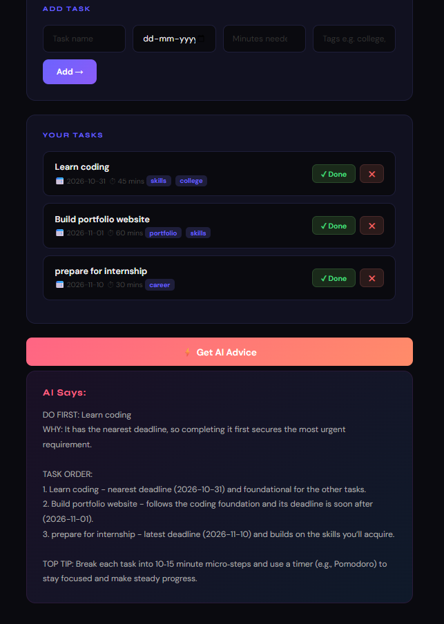

# FocusIQ: AI Task Prioritizer

> Know exactly what to work on right now.

🔗 **Live app:** [focusiq-pwr6.onrender.com](https://focusiq-pwr6.onrender.com) (free tier, may take ~30s to wake up)



## Why I Built This

I kept getting stuck choosing between studying, building projects, applying for internships, and prepping for interviews.

Every task felt urgent. I never knew what to actually work on right now.

Most task managers just store tasks. They don't help you decide. FocusIQ does one thing: it looks at everything on your plate and tells you where to focus, based on your deadlines and how much energy you have.

Built for students. Runs in your browser, no setup needed.

## Features

- Add tasks with deadlines, time estimates, and tags
- Urgency indicators: `[URGENT]` / `[SOON]` / `[OK]`
- See your top priority task every time you open the app
- Mark tasks complete and track progress
- Delete tasks you no longer need
- AI advisor tells you exactly what to work on based on your energy level

## Getting Started

### Use it live

Just visit [focusiq-pwr6.onrender.com](https://focusiq-pwr6.onrender.com)

### Run it locally

```bash
git clone https://github.com/kishankshetty77/focusiq.git
cd focusiq
pip install -r requirements.txt
```

Create a `.env` file with your Groq API key (get a free one at [console.groq.com/keys](https://console.groq.com/keys)):

```
GROQ_API_KEY=your_key_here
```

Run it:

```bash
python app.py
```

Then open http://localhost:5000

## Project Structure

```
focusiq/
├── app.py           # Flask app, routes including /advise
├── models.py        # Task data model
├── storage.py       # Load and save tasks
├── ai_advisor.py    # Groq API integration for AI prioritization
├── templates/       # HTML templates (frontend)
├── tasks.json       # Task data (gitignored in production)
├── requirements.txt
├── Procfile         # Render deployment config
└── README.md
```

## How the AI Feature Works

Add your tasks with deadlines, time estimates, and tags, then click **⚡ Get AI Advice**. The app sends your task list to the model on Groq, which returns:

- Your top priority task, with reasoning
- A suggested task order
- A practical tip for tackling it

## Built With

- **Python + Flask**: backend web framework
- **Groq API (model="openai/gpt-oss-120b",)**: AI-powered task prioritization
- **Render**: deployment and hosting

## License

MIT
